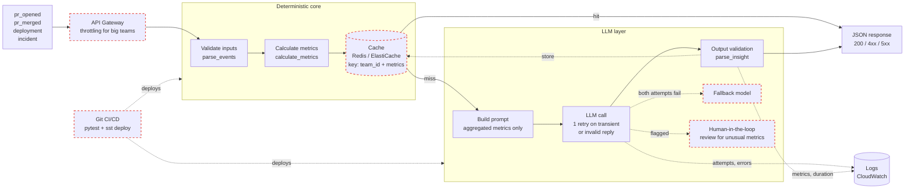

# review

Team-level engineering productivity insights: validate raw engineering events,
calculate deterministic metrics, and ask an injected LLM client for a summary
and recommendations based on the aggregated metrics only.

## Requirements

- Python 3.10+
- Standard library only for the core (`pytest` for tests)

## Setup

```bash
python3 -m venv .venv
source .venv/bin/activate
pip install -e ".[dev]"
```

## Running tests

```bash
pytest
```

## Usage

```python
from app.team_insight import generate_team_insight

result = generate_team_insight(
    "platform",
    [
        {"type": "pr_opened", "id": "pr-1", "timestamp": "2026-01-01T09:00:00Z"},
        {"type": "pr_merged", "id": "pr-1", "timestamp": "2026-01-02T09:00:00Z"},
        {"type": "deployment", "timestamp": "2026-01-03T12:00:00Z"},
        {"type": "incident", "timestamp": "2026-01-04T12:00:00Z"},
    ],
    llm_client,  # any object with complete(prompt: str, timeout_seconds: float) -> str
)
```

```json
{
  "team_id": "platform",
  "metrics": {
    "merged_prs": 1,
    "average_pr_cycle_time_hours": 24.0,
    "deployments": 1,
    "incidents": 1
  },
  "insight": {
    "summary": "Healthy delivery flow.",
    "recommendations": ["Monitor cycle time."]
  }
}
```

The same example runs as a test with a fake client:

```bash
pytest tests/test_example.py
```

## Architecture



Solid boxes exist in this repo; dashed red boxes are planned. Each stage only
receives the output of the previous one, so raw events never get past the
deterministic core.

| Component | Where | Status |
| --- | --- | --- |
| Validate inputs | `parse_events` in `src/app/team_insight.py` | Implemented |
| Calculate metrics | `calculate_metrics` | Implemented |
| Build prompt (aggregates only) | `build_prompt` | Implemented |
| LLM call with one retry | `request_insight` | Implemented, provider not wired (`create_llm_client`) |
| Output validation | `parse_insight` | Implemented |
| Logs | `logging` in the module; CloudWatch receives Lambda logs automatically | Implemented |
| HTTP entry point | `functions/src/functions/api.py` + `sst.config.ts` | Configured, not deployed |
| Throttling for big teams | API Gateway route throttling, or a queue (SQS) for very large event sets | Planned |
| Cache | Redis / ElastiCache, keyed by `hash(team_id + metrics)` | Planned |
| Fallback model | Second, cheaper or different provider after the retry is exhausted | Planned |
| Human-in-the-loop review | Queue insights for review when metrics look unusual (e.g. incident spike) | Planned |
| Git CI/CD | Run `pytest` on every PR, `sst deploy --stage production` on merge to `main` | Planned |

The cache sits after metric calculation rather than after validation: metrics
are deterministic, so two requests with different raw events but identical
metrics produce the same prompt and can share one LLM answer.

## How it works

Everything lives in `src/app/team_insight.py`, in four independent stages:

1. **Validation** (`parse_events`): every event must be a dict with a known
   `type` and a `timestamp` in the exact form `YYYY-MM-DDTHH:MM:SS[.ffffff]Z`.
   PR events also need a non-empty `id`. Any malformed record raises
   `InvalidEventError` naming the event index and field.
2. **Metrics** (`calculate_metrics`): `pr_opened` and `pr_merged` are matched by
   `id`. Unmatched events are ignored for cycle time; duplicates and
   merged-before-opened raise. The average is `null` when no PR is matched.
3. **Prompt** (`build_prompt`): built from `team_id` and `TeamMetrics` only. It
   never receives the event list, so raw ids and timestamps cannot leak.
4. **LLM reply** (`parse_insight`, `request_insight`): the reply must be a JSON
   object with a non-empty string `summary` and a list of non-empty string
   `recommendations` (a surrounding ```` ```json ```` fence is tolerated).

### Errors

| Exception | Cause | Suggested HTTP status |
| --- | --- | --- |
| `InvalidEventError` (also a `ValueError`) | bad `team_id` or event | 400 / 422 |
| `InvalidLLMResponseError` | reply invalid on both attempts | 502 |
| `LLMUnavailableError` | transient failure on both attempts | 503 |
| `TransientLLMError` | raised *by the client* for timeouts / throttling | — |

All except `TransientLLMError` share the base class `TeamInsightError`.

### Retry policy

At most **two** LLM calls (one retry). A retry happens on `TransientLLMError`,
`TimeoutError`, `ConnectionError`, or an invalid reply. Any other exception is
treated as a bug and propagates immediately. `timeout_seconds` (default 10s) is
passed to the client **per attempt**, so the worst case is about 2 × timeout.

## Design decisions and trade-offs

| Decision | Why | Alternative |
| --- | --- | --- |
| Strict timestamp format checked with a regex, then `strptime` | Same accepted inputs on Python 3.10 and 3.12; `fromisoformat` became more lenient in 3.11 and silently treats date-only values as local time | Accept any ISO 8601 via `fromisoformat` (more permissive, version-dependent) |
| Malformed input raises instead of being skipped | The spec says not to silently accept bad records; partial metrics would look correct but be wrong | Skip bad events and return a list of warnings |
| `merged_prs` counts merges even without a matching `pr_opened` | The merge happened in the window; only the cycle time is unknown | Count only matched PRs |
| Average is `null`, not `0`, with no matched PRs | `0` would read as "instant merges" | Omit the field |
| Invalid LLM replies are retried once | LLM output is non-deterministic; a second sample often succeeds | Fail immediately (cheaper, faster) |
| No sleep between attempts | Only one retry; keeps the function fast and tests deterministic | Exponential backoff with jitter (worth adding with more retries) |
| No fallback insight when the LLM fails | The spec requires rejecting invalid replies; a template could hide outages | Return metrics with a templated insight and a `degraded` flag |
| Timeout is a client parameter, not enforced here | Standard library has no portable way to cancel a sync call; providers' SDKs already support timeouts | Run the call in a thread with a deadline |
| Single module | Small scope; easy to read top to bottom | Split into `events`, `metrics`, `llm`, `service` as it grows |
| No per-engineer data | Events carry no author, and the prompt forbids individual comparisons | — |

## Production considerations

### FastAPI

- `POST /teams/{team_id}/insights` with Pydantic request/response models that
  mirror the `TypedDict`s; cap the number of events per request (e.g. 10k).
- Provide the LLM client through `Depends`, so tests can override it.
- Use a plain `def` endpoint: the core is synchronous, so FastAPI runs it in a
  threadpool instead of blocking the event loop.
- Exception handlers map errors to 400 / 502 / 503 as in the table above; never
  return internal messages from unexpected exceptions.
- Authenticate callers and authorise them for the requested `team_id`.

### AWS Lambda

- Thin handler: parse the API Gateway body, call `generate_team_insight`, map
  errors to status codes.
- Create the LLM client outside the handler so warm invocations reuse it.
- Budget the Lambda timeout for two LLM attempts plus overhead, and keep it
  under API Gateway's 29s integration limit (e.g. 10s per attempt).
- Read the provider API key from Secrets Manager or an environment variable;
  never log it.

This is implemented in `functions/src/functions/api.py` and deployed with SST
(see [Deploying to AWS with SST](#deploying-to-aws-with-sst)).

### Timeouts

Per-attempt timeout in the client, overall budget = attempts × timeout. With
more retries, add a total deadline so the caller's timeout is never exceeded.

### Observability

- The module logs through `logging.getLogger("app.team_insight")`: one warning
  per failed LLM attempt (error type only) and one info line per success with
  `team_id`, event count, aggregated metrics and `duration_ms`.
- In production, emit JSON logs with a request id, and export metrics for
  LLM latency, retries, failures by type and token cost per team.

### Idempotency and caching (Redis / ElastiCache)

Metrics are deterministic, so the same events always produce the same prompt.
Cache the insight under `hash(team_id + metrics)` with a TTL: repeated or
retried requests return the same answer without another LLM call, which also
makes the endpoint effectively idempotent. Accept an `Idempotency-Key` header
for clients that retry on network errors.

### Persistence (DynamoDB / Aurora / MySQL)

Store the result, not the raw events or prompt: DynamoDB with
`PK = team_id`, `SK = generated_at`, or an `insights` table in Aurora/MySQL
keyed by `(team_id, generated_at)`. Useful for history, trends and audit.

### Privacy

- Only aggregated, team-level numbers reach the LLM; no PR ids, timestamps or
  people.
- Logs contain the same aggregates, never events, prompts, replies or keys.
- Error messages name the event index and field, not the event content.
- Check the LLM provider's data retention terms before sending anything.

### Rate limiting and cost

- Rate limit per caller and per team (API Gateway usage plans or a Redis token
  bucket) so one team cannot exhaust the LLM quota.
- The cache above removes most duplicate LLM calls; set a daily cost budget
  and alert on it.
- On provider throttling (HTTP 429), the client should raise
  `TransientLLMError` so the single retry applies.

## Deploying to AWS with SST

The repo is set up for [SST](https://sst.dev) (v4) but has not been deployed.
`sst.config.ts` defines an API Gateway HTTP API with one route backed by a
Python 3.12 Lambda:

```
POST /teams/{team_id}/insights
{"events": [...]}
```

| Status | When |
| --- | --- |
| 200 | Insight generated (same body as `generate_team_insight`) |
| 400 | Body is not a JSON object, or `InvalidEventError` |
| 413 | More than 10,000 events |
| 501 | No LLM provider wired yet (current state) |
| 502 | `InvalidLLMResponseError` |
| 503 | `LLMUnavailableError` |
| 500 | Anything else (details only in the logs) |

The Lambda timeout is 25s: two LLM attempts of `LLM_TIMEOUT_SECONDS` (10s)
plus overhead, under API Gateway's 29s limit.

### Before the first deploy

1. Implement `create_llm_client()` in `functions/src/functions/api.py` for the
   chosen provider. Map timeouts, throttling and 5xx responses to
   `TransientLLMError`.
2. Uncomment the `LlmApiKey` secret and `LLM_API_KEY` environment variable in
   `sst.config.ts`.
3. Add authentication to the route (e.g. an IAM or JWT authorizer).

### Commands

Requires Node.js, [uv](https://docs.astral.sh/uv/) and AWS credentials.

```bash
npm install
uv sync --all-packages                              # SST packages the Lambda with uv
npx sst secret set LlmApiKey <value> --stage dev    # once the secret is enabled
npx sst dev                                         # live Lambda against a dev stage
npx sst deploy --stage production
npx sst remove --stage dev
```

SST's Python support is community-maintained. The handler is a uv workspace
member (`functions/`) that depends on the `app` package at the repo root, so
only the standard library ships in the Lambda bundle.

## Project layout

```
src/app/team_insight.py      # the service
functions/src/functions/api.py  # Lambda handler (HTTP request -> service -> HTTP response)
sst.config.ts                # SST infrastructure (API Gateway + Lambda)
tests/fakes.py               # shared test data and fake LLM clients
tests/test_lambda_handler.py # Lambda handler status codes and request parsing
tests/test_example.py        # reference example from the task statement
tests/test_team_insight.py   # unit and end-to-end tests per stage
tests/test_edge_cases.py     # niche scenarios (timestamps, rounding, retries, injection)
docs/PLAN.md                 # original plan
```
